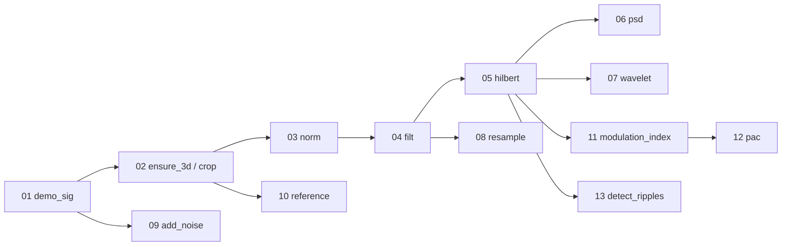
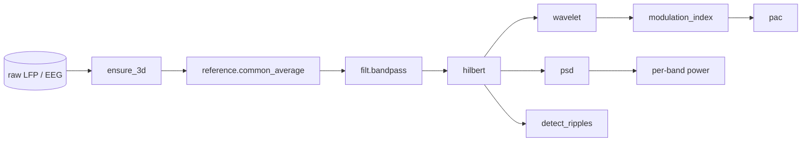

# scitex-dsp

<p align="center">
  <a href="https://scitex.ai">
    
  </a>
</p>

<p align="center"><b>Digital signal processing for scientific Python — PAC, Hilbert, wavelet, filters, resampling, demo signals.</b></p>

<p align="center">
  <a href="https://scitex-dsp.readthedocs.io/">Full Documentation</a> · <code>uv pip install scitex-dsp[all]</code>
</p>

<!-- scitex-badges:start -->
<p align="center">
  <a href="https://pypi.org/project/scitex-dsp/"></a>
  <a href="https://pypi.org/project/scitex-dsp/"></a>
  <a href="https://scitex-dsp.readthedocs.io/en/latest/"></a>
</p>
<p align="center">
  <a href="https://github.com/ywatanabe1989/scitex-dsp/actions/workflows/test.yml"></a>
  <a href="https://github.com/ywatanabe1989/scitex-dsp/actions/workflows/scitex-quality.yml"></a>
  <a href="https://codecov.io/gh/ywatanabe1989/scitex-dsp"></a>
</p>
<!-- scitex-badges:end -->

---

## Problem and Solution

| # | Problem | Solution |
|---|---------|----------|
| 1 | **Shape mismatch.** Pipelines mix NumPy, SciPy, MNE, and PyTorch with incompatible array shapes. | **Uniform 3-D contract.** `scitex_dsp` exposes `(batch, channel, time)` via `ensure_3d` and the `@torch_fn` decorator. |
| 2 | **Scattered methods.** PAC, wavelets, and ripple detection live in one-off scripts. | **First-class primitives.** `pac`, `wavelet`, `hilbert`, `detect_ripples`, `modulation_index`. |
| 3 | **Re-rolled fixtures.** Demo signals for testing are rebuilt by every project. | **Deterministic signals.** `demo_sig(sig_type=...)` makes chirp, periodic, and ripple test signals. |

## Demo

A 13-notebook progressive tutorial lives in [`examples/`](examples/),
committed with executed cell outputs — read on GitHub without running
anything locally.



<p align="center"><sub><b>Figure 3.</b> Tutorial path through <code>examples/</code>: signals and shaping first, then filtering, spectra, coupling, and events.</sub></p>

See [`examples/README.md`](examples/README.md) for the full index
and suggested reading paths.

<p align="center"><sub><b>Table 2.</b> Tutorial notebooks and the reference implementation each cross-checks.</sub></p>

| # | Notebook | Topic | Cross-check |
|---|---|---|---|
| 01 | [`01_demo_sig.ipynb`](examples/01_demo_sig.ipynb) | synthetic test signals — uniform / gauss / periodic / chirp | — |
| 04 | [`04_filt.ipynb`](examples/04_filt.ipynb) | Butterworth bandpass / bandstop | — |
| 05 | [`05_hilbert.ipynb`](examples/05_hilbert.ipynb) | analytic signal — phase + envelope | `scipy.signal.hilbert` |
| 06 | [`06_psd.ipynb`](examples/06_psd.ipynb) | PSD + per-band integrated power | — |
| 07 | [`07_wavelet.ipynb`](examples/07_wavelet.ipynb) | continuous wavelet transform | — |
| 09 | [`09_add_noise.ipynb`](examples/09_add_noise.ipynb) | gauss / white / pink / brown — traces + PSDs | — |
| 12 | [`12_pac.ipynb`](examples/12_pac.ipynb) | phase-amplitude coupling heatmap | `tensorpac.Pac` |
| 13 | [`13_detect_ripples.ipynb`](examples/13_detect_ripples.ipynb) | end-to-end ripple detection — DataFrame + shaded events | — |

Re-run them all with `./examples/00_run_all.sh`.

## Installation

```bash
uv pip install "scitex-dsp[all]"
```

<details>
<summary><b>Minimal install and extras</b></summary>

<br>

| Extra | Pulls in |
|---|---|
| (none) | pandas, matplotlib, numpy, scipy, torch, xarray + scitex core libs (minimal runtime) |
| `all` | `tensorpac`, `sounddevice`, `pycatch22`, `scikit-learn`, `gpu-pac` GPU-PAC engine (recommended) |
| `dev` | pytest, ruff + every optional dep so the test suite runs |
| `docs` | Sphinx + RTD theme + myst-parser (docs build only) |

<p align="center"><sub><b>Table 1.</b> Install extras: bare install is the minimal runtime, <code>[all]</code> is batteries-included.</sub></p>

```bash
uv pip install scitex-dsp      # minimal runtime
uv pip install -e ".[dev]"     # editable install for contributors
```

</details>

## Architecture

`scitex_dsp` is organised as flat building blocks plus four
sub-modules. Public entry points compose left-to-right into typical
neuroscience pipelines:



<p align="center"><sub><b>Figure 1.</b> Pipeline architecture: flat building blocks compose left-to-right from raw LFP/EEG to spectra, coupling, and events.</sub></p>

```
src/scitex_dsp/
├── _hilbert.py   _psd.py        _wavelet.py
├── _pac.py       _modulation_index.py
├── _detect_ripples.py
├── _resample.py  _crop.py       _ensure_3d.py
├── _demo_sig.py  _transform.py
├── filt.py       norm.py        reference.py
├── add_noise.py  params.py      example.py
└── utils/        # ensure_*, zero-pad, differential filters
```

<p align="center"><sub><b>Figure 2.</b> Module layout: spectral primitives, signal utilities, and synthesis helpers under <code>src/scitex_dsp/</code>.</sub></p>

All public functions accept `(channels, samples)` or
`(batch, channels, samples)`.

## Feature Extraction

A named-scalar feature front-end turns a signal (or a PAC map) into a
flat, self-documenting `{names, values}` descriptor — every value is
traceable to its registry entry.

```python
import scitex_dsp as dsp

# Canonical PAC-summary set from a PAC map (+ its provenance registry).
feats = dsp.pac_features(pac_z)          # {"names": [...], "values": [...]}
dsp.PAC_FEATURE_REGISTRY                  # what each feature means / how it is computed

# Multi-backend front-end over many engines (pac + catch22) in one call.
out = dsp.extract_all(x, fs)              # {"names": [...], "values": [...]}
dsp.AVAILABLE_BACKENDS                     # ("pac", "catch22")
dsp.extract_all_registry()                 # provenance for every emitted feature

# Real GPU-PAC engine (opt-in); "auto" keeps the CPU-safe default.
pac, f_pha, f_amp = dsp.pac(x, fs, backend="gpac")

# Quantify how much a mixed feature set duplicates itself.
dsp.feature_correlation(X, names)
dsp.redundancy_summary(X, names)
dsp.pca_loadings(X, names)
dsp.correlation_by_group(X, names)
```

The pip-installable optionals (`tensorpac`, `pycatch22`, `scikit-learn`,
`sounddevice`, and the `gpu-pac` GPU-PAC engine behind
`pac(backend="gpac")`) ship in a single `[all]` extra: `pip install
scitex-dsp[all]` (or, for just the GPU engine, `pip install gpu-pac`).

## 2 Interfaces

<details open>
<summary><strong>Python API</strong></summary>

<br>

```python
import scitex_dsp as dsp

xx, tt, fs = dsp.demo_sig(sig_type="chirp", fs=1024)
psd, ff = dsp.psd(xx, fs)
xf = dsp.filt.bandpass(xx, fs, bands=[[8, 12]])
hp = dsp.hilbert(xx)
pac, freqs_pha, freqs_amp = dsp.pac(xx, fs)
```

</details>

<details>
<summary><strong>Importable from the umbrella</strong></summary>

<br>

```python
import scitex
scitex.dsp.demo_sig(sig_type="chirp")  # `scitex.dsp` aliases `scitex_dsp`
```

</details>

## Part of SciTeX

`scitex-dsp` is part of [**SciTeX**](https://scitex.ai).

Install via the umbrella with `pip install scitex[dsp]`, then access as `scitex.dsp` or run `scitex dsp` from the CLI.

>Four Freedoms for Research
>
>0. The freedom to **run** your research anywhere — your machine, your terms.
>1. The freedom to **study** how every step works — from raw data to final manuscript.
>2. The freedom to **redistribute** your workflows, not just your papers.
>3. The freedom to **modify** any module and share improvements with the community.
>
>AGPL-3.0 — because we believe research infrastructure deserves the same freedoms as the software it runs on.

---

<p align="center">
  <a href="https://scitex.ai" target="_blank"></a>
</p>
